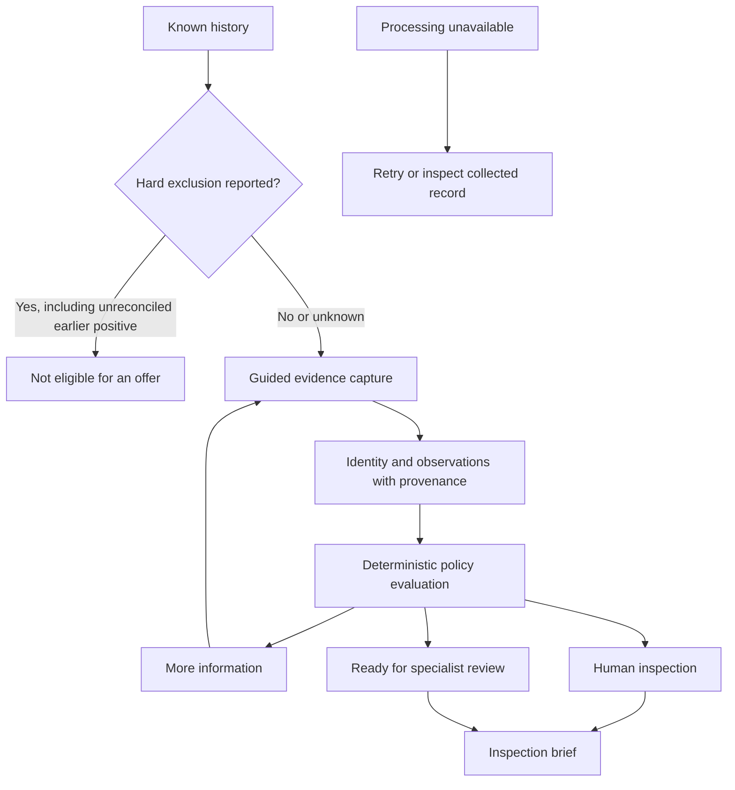

# Product strategy: Relay

Working product name: **Relay**. Preparation baseline: **2026-10-26 (UTC)**. Name clearance has not been performed. This is an experimental preparation product; permission to reuse pre-event code or assets at the competition is unresolved.

## Positioning

**Relay turns a rider's photographs and known history into a clear inspection brief, so a specialist can decide what deserves a closer look.**

The value proposition is a useful, traceable next step. Relay does not certify protection, authenticate every item, estimate an unsupported price or promise that the business will purchase it.

Editorial line: **“A second life, considered.”** This expresses intent. It must never imply that every submitted garment can be safely reused, that an offer is guaranteed, or that environmental benefits have been measured.

## The problem worth solving

The supplied brief describes a journey from a rider's photo to whether an offer should be considered. It explicitly excludes offers for crashed gear and protective-area damage/repair, and forbids protective-performance certification. These are product constraints, not optional disclaimer copy. Listings, shipping, repairs and model training are outside scope.

Our working operational hypothesis is that **missing history, inconsistent photographs and unclear evidence create avoidable clarification work for assessors**. This has not been measured at Moto Reloaded. It is plausible from analogous systems: Ravin separates guided capture from reviewer tools; Apple and Patagonia distinguish an estimate from inspection; Entrupy distinguishes insufficient/unsupported evidence from completed outcomes. [Ravin](https://www.ravin.ai/), [Apple](https://www.apple.com/shop/trade-in), [Patagonia](https://www.patagonia.com/trade-in/), [Entrupy states](https://developer.entrupy.com/docs/api/data-model)

The rider and business should gain value from the same record:

| Stakeholder | Intended value | Evidence needed before claiming improvement |
|---|---|---|
| Rider | Fewer unclear instructions, useful correction, a specific next action. | Observed completion and comprehension; comparison against an unguided baseline. |
| Assessor | Consistent views, explicit history and visible uncertainty. | Expert ratings and fewer clarification requests on matched cases. |
| Operator | Conservative, auditable screening with measured operating cost. | Safety tests, scenario evaluation and actual inference/cost logs. |
| Competition judges | A coherent mobile demonstration of real image processing and meaningful human involvement. | Reproducible live flow, a hard case and honest benchmark evidence. |

## Differentiation to test

1. **The capture plan responds to missing evidence.** Start with a compact view set; request a detail only when it can change the next step.
2. **The record separates who said what.** Owner history, camera evidence, model observation, correction and human decision remain distinguishable.
3. **The decision can be conservative and still useful.** A human-inspection route includes a ready-to-read brief rather than an unexplained failure.
4. **The visual experience respects the object.** Precise editorial composition, actual garment imagery and calm materials replace a generic AI dashboard.
5. **Failure is designed.** Provider errors, unknown history and wrong recognition have visible recovery without silently turning into favourable assessments.

These are proposed advantages, not established competitive wins. Direct user reports in adjacent markets show that disputed identity, unexplained reversals and difficult recovery can undermine trust; they do not prove Relay fixes those problems. [Comparative research and source limits](../04-competitive-research/comparative-workflows.md)

## Decision-support model

This diagram explains intended policy structure; it is not a claim of implemented persistence or a connected reviewer queue. The human decision remains outside automated approval.

| State | Business meaning |
|---|---|
| `not_eligible` | A hard exclusion is present. No offer recommendation is permitted. |
| `more_information` | Required history or photographic evidence is unresolved. |
| `human_inspection` | A possible concern, unsupported category, inconsistency or analysis limitation needs an expert. |
| `ready_for_review` | The current intake requirements are met; a specialist may consider the record. This is not a purchase recommendation. |
| Processing unavailable | The analysis operation did not complete reliably. It cannot confer positive eligibility. |

Known positives remain effective when a rider changes an answer; factual corrections require reconciliation rather than silent erasure. A category-only model cannot establish condition and must not unlock review readiness.

## Scope and prioritisation

**Preparation core:** mobile-oriented history, camera/import flow, evidence review and corrections, a real image-analysis path, independent exclusion rules, an inspection brief, bounded failure handling, and clear documentation.

**Highest-value validation next:** real garment diversity; expert interpretation of protective areas; guided-versus-unguided evidence utility; physical iPhone/Android camera lifecycle; accessibility; model calibration and condition-observation failures.

**Conditional additions:** adaptive detail requests only when the current observations can support them; persisted draft recovery only with verified storage/deletion; reviewer handoff only with a real destination and explicit user action. A button that merely changes text is not a handoff.

**Outside the competition scope:** marketplaces, checkout, shipping, repair recommendations, trained garment models, fake resale pricing, customer identity verification, social features and speculative sustainability counters.

**Do not optimise for:** maximum offer rate, maximum apparent confidence, more AI calls, minimum taps at the expense of disclosures, or a universally favourable result.

## Success measures

The intended primary outcome is **a review-useful packet with correct safety routing**. Track:

- Safety exclusion violations, with exact test cases and denominators.
- Expert-rated evidence completeness and unresolved ambiguity.
- Assessor clarification burden compared with a matched baseline.
- Rider understanding of the result, correction success and completion.
- End-to-end capture time, analysis latency, failure rate and retry burden.
- Actual cost per completed assessment, separating paid calls from local processing and estimates from invoices.

No baseline, improvement percentage or target latency has yet been established by this strategy document. The [validation protocol](../05-user-and-workflow-research/journey-and-validation.md) defines how to collect evidence.

## Preparation sequence and competition adaptation

The interval from this baseline to the event is 26 days. Dates below are a proposed work sequence, not booked sessions or promised completions.

| Period (UTC dates) | Most important evidence / result |
|---|---|
| Oct 26–Nov 1 | Establish reproducible experimental core, compare model options, document data/asset rights and organizer questions. |
| Nov 2–8 | Expert and rider sessions where recruitable; evaluate diverse gear and improve capture/recovery from observed failures. |
| Nov 9–15 | Repeat changed scenarios; physical-device and accessibility checks; measure costs/latency; rehearse a hard case. |
| Nov 16–20 | Freeze the preparation baseline; audit reuse permissions; prepare from-scratch instructions and verify demo contingencies. |
| Nov 21 event | Read the agreement/rubric, resolve permitted reuse, label official data, adapt category/policy configuration, build the authorized submission and run safety gates before presenting. |

Competition-day priorities must be reset against the actual rubric. Keep policy rules, capture recipes and provider integrations modular so a new category does not require redesigning the entire journey.

## Questions that require organizer or expert answers

1. Which advance code, assets, templates, dependencies and research materials can be reused, and what must be created on the day?
2. What is the actual purchase-consideration policy, including categories, age/material concerns and protective-area definitions?
3. Does the required output stop at screening, recommend specialist consideration, or include a real offer process?
4. Who makes the physical review decision, what evidence do they need, and what turnaround can actually be promised?
5. What dataset licence, privacy, ground-truth and evaluation restrictions apply?
6. How will user experience, safety, recognition, latency, operating cost and originality be weighted?
7. What smartphone, connectivity and presentation arrangements are available?

These questions are prepared for the user; no message has been sent to the organizers.
