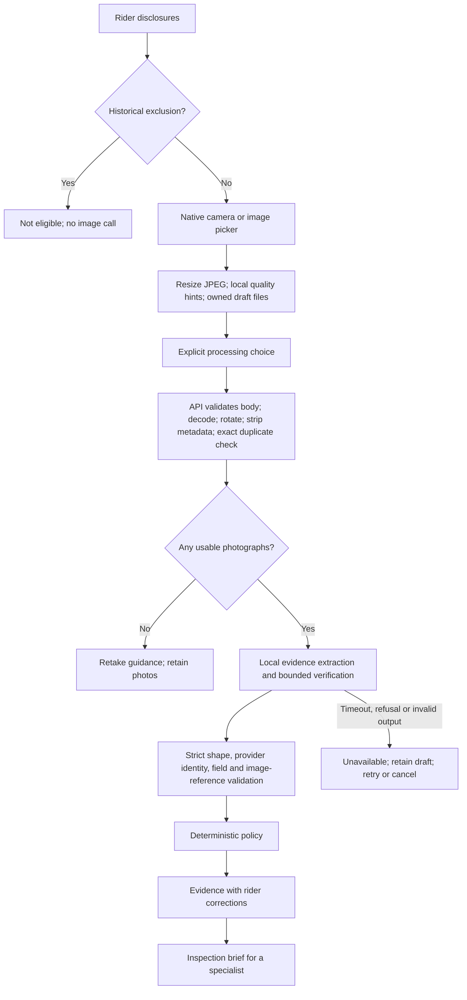

# Implemented architecture
Checkpoint: 2026-10-26. Source authority: packages/core, packages/vision, server and app. This document describes the experiment, not a public production service.

## Current inspection profile

The default adapter is local_vlm: pinned Qwen3.5 4B on an isolated loopback runtime. Single usable photographs are inspected before history and view completeness checks. Exposure-blocked photos remain in the record but are explicitly unassessed; usable views still produce evidence. Low-resolution empty results request a clearer photograph. Photo evidence is cached by normalized pixels, model digest and prompt version; IDs are rebound on reuse. Policy version 2026-10-26.2 is recomputed in the client.

The notebook retains saved briefs and photos until explicit removal. A policy upgrade drops obsolete analysis while preserving draft evidence. Small trained networks are separate research, described in [small specialists](small-specialists.md).

## Data flow

## Modules and trust
- **app/src/useRelay.ts:** interaction ownership, cancellation, evidence changes, explicit provider consent and UI state. A new/deleted draft invalidates previous work. Evidence changes invalidate in-flight analysis.
- **app/src/session.ts:** versioned device draft; owned image files; serialized metadata writes; recoverable deletion tombstone; restart cleanup. Expiry is checked on opening after 24 hours of inactivity. This is not encrypted medical-grade storage.
- **packages/core/schema.ts:** strict request/response, observation, disclosure, correction and quality schemas (1.0). Bounded arrays/text reject unexpected fields.
- **packages/core/policy.ts:** fixed event exclusions and four decision states. Historical yes remains exclusionary. No model owns policy. All outputs explicitly set offerRecommended and protectivePerformanceCertified to false.
- **packages/core/recovery.ts:** a missing/unclear view points to its exact capture slot; history uncertainty points to history.
- **server/images.ts:** 4.2 MB per encoded photo after decoding, 24 MP decode limit, still JPEG/PNG/WebP, orientation normalization, max 1600 px, metadata-free JPEG, 192 px quality sample. SHA-256 checks exact normalized duplicates, not same-item authenticity.
- **packages/vision/local.ts:** pinned pretrained CLIP/SigLIP on CPU; no training; two fixed prompt formulations; conflicting views/wordings abstain. Category-only scope is enforced again at API and policy boundaries.
- **packages/vision/openai.ts / validation.ts:** optional server-side paid adapter; explicit model/key and startup authorization flag required. Strict structured output, image provenance and narrow field vocabulary. Label text remains unverified.
- **server/app.ts:** authenticated LAN mode, bounded body, one active inference, in-flight coalescing, 24-result memory cache, ten-minute scheduled expiry, generation-aware clearing. No photo/body logging.

## Evidence authority
| Record | Source | Permitted interpretation |
|---|---|---|
| Disclosure event | Rider, timestamped event order | A report; not independently verified history |
| Photo | Device, view label, normalized hash | Captured evidence; requested view label is not proof the view is correct |
| Category | Named model and revision | Appearance inference, not authenticity |
| Visible label text | Model transcription linked to image ID | Quoted, unverified text |
| Material | Constrained model inference | Coarse appearance hypothesis |
| Concern | Structured model flag linked to image ID | Suspected feature, not an expert finding |
| Correction | Rider, preserved alongside observation | A report for reconciliation |
| Policy state | Versioned deterministic engine | Next permitted workflow step |
| Expert conclusion | Not implemented as an authenticated record | Must happen outside the experimental app |

## API contract
GET /health returns schema/policy/provider/model identity. POST /assess accepts schemaVersion, assessmentId, disclosure event array, corrections, up to six base64 images with IDs/views, and explicit consent. External requests must name the expected provider and model; a mismatch returns 409 before decoding or inference. Successful responses include validated evidence, observation or null, decision and stage timing. No image bytes return in the response.

Failure classes: 400 invalid request, 401 missing/wrong session token, 403 external consent missing, 409 provider identity changed, 413 body/image size, 422 invalid/duplicate image, 429 active inference, 503 invalid/unavailable analysis. There is no silent fallback to a favorable result and no automatic paid retry.

DELETE /session clears the single-owner service cache and invalidates late cache writes. The mobile removal control explicitly removes this device's draft; it does not claim to delete shared copies or provider records. Cache/timeout mechanics have injected-adapter tests; native emulator transport/cancellation was exercised; physical-phone transport still requires verification.

## Deliberate limits
This is one local owner/session, not tenant-isolated SaaS. Rider honesty and consistent garment capture cannot be guaranteed. The default local VLM produces unverified visible-condition findings. Legacy CLIP/SigLIP remain category-only. No local label/logo specialist is validated. Cloud extraction has not been live-evaluated. Source URL/model availability, privacy permissions and business offer policy require validation before real commercial use. No prices, payouts, or offers are fabricated.
